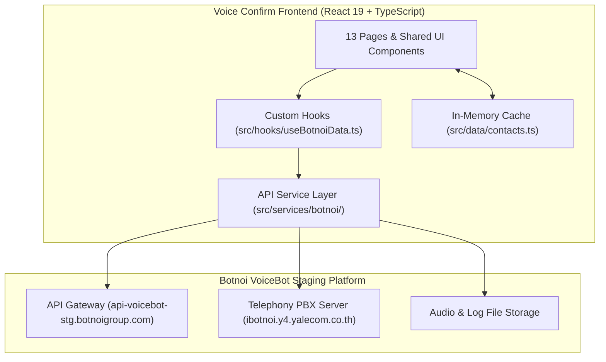
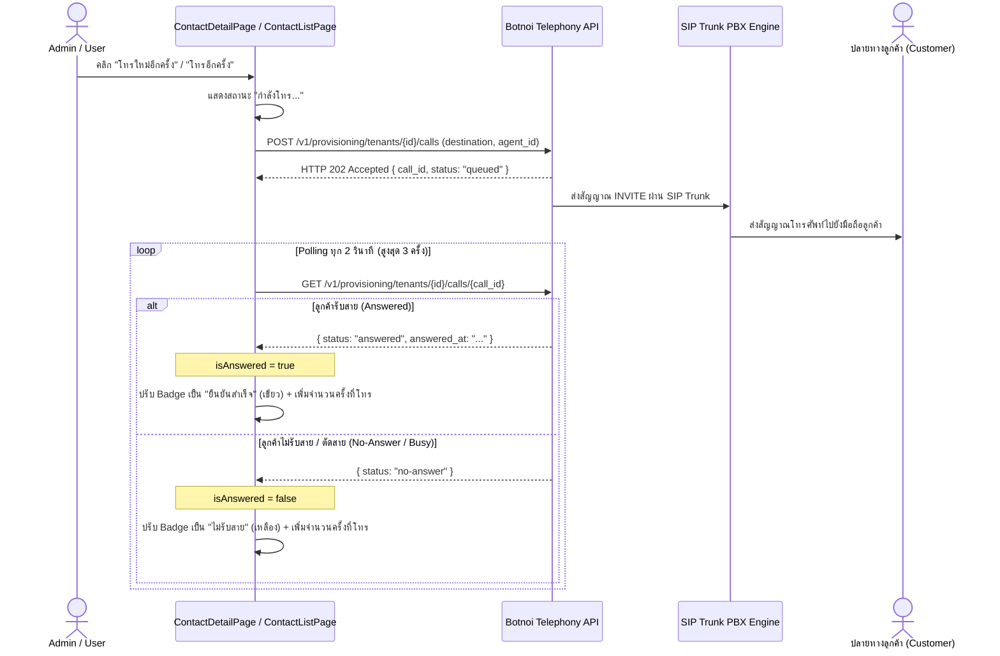

# Voice Confirm — API Integration Documentation
## คู่มือและเอกสารอ้างอิงการเชื่อมต่อ Botnoi VoiceBot API (9 กลุ่มงาน ครบ 35 Endpoints)

> **สถานะ**: Production-Ready API Integration  
> **เวอร์ชัน API**: Botnoi VoiceBot API (Staging Environment)  
> **วันที่จัดทำ**: 7 ตุลาคม 2026  
> **Base URL**: `https://api-voicebot-stg.botnoigroup.com`  
> **PBX SIP Trunk Host**: `ibotnoi.y4.yalecom.co.th` (พอร์ต 5060)  

---

## สารบัญ (Table of Contents)

1. [ภาพรวมสถาปัตยกรรม (Architecture Overview)](#1-ภาพรวมสถาปัตยกรรม-architecture-overview)
2. [การยืนยันตัวตนและความปลอดภัย (Authentication & Security)](#2-การยืนยันตัวตนและความปลอดภัย-authentication--security)
3. [กฎและพฤติกรรมเฉพาะของ API (Critical API Quirks & Edge Cases)](#3-กฎและพฤติกรรมเฉพาะของ-api-critical-api-quirks--edge-cases)
4. [รายละเอียด API ทั้ง 9 กลุ่ม และ 35 Endpoints (API Reference)](#4-รายละเอียด-api-ทั้ง-9-กลุ่ม-และ-35-endpoints)
   - [Group 1: Account (1 Endpoint)](#group-1-account-1-endpoint)
   - [Group 2: Agents (4 Endpoints)](#group-2-agents-4-endpoints)
   - [Group 3: Catalog (2 Endpoints)](#group-3-catalog-2-endpoints)
   - [Group 4: Telephony Setup (12 Endpoints)](#group-4-telephony-setup-12-endpoints)
   - [Group 5: Outbound Calls & Status (2 Endpoints)](#group-5-outbound-calls--status-2-endpoints)
   - [Group 6: Conversation Logs & Audio (5 Endpoints)](#group-6-conversation-logs--audio-5-endpoints)
   - [Group 7: Dashboard Analytics (1 Endpoint)](#group-7-dashboard-analytics-1-endpoint)
   - [Group 8: Platform Tools (4 Endpoints)](#group-8-platform-tools-4-endpoints)
   - [Group 9: Web Preview Call & Logs (4 Endpoints)](#group-9-web-preview-call--logs-4-endpoints)
5. [ตารางเชื่อมโยงโค้ดในระบบ (Frontend Code Mapping Matrix)](#5-ตารางเชื่อมโยงโค้ดในระบบ-frontend-code-mapping-matrix)
6. [ลำดับการทำงานของสายโทรศัพท์ (PBX Call Flow Diagram)](#6-ลำดับการทำงานของสายโทรศัพท์-pbx-call-flow-diagram)
7. [แนวทางการเชื่อมต่อฐานข้อมูล Supabase ในอนาคต (Supabase Migration Blueprint)](#7-แนวทางการเชื่อมต่อฐานข้อมูล-supabase-ในอนาคต-supabase-migration-blueprint)

---

## 1. ภาพรวมสถาปัตยกรรม (Architecture Overview)

ระบบ **Voice Confirm** ทำหน้าที่เป็นศูนย์กลางการบริหารจัดการแคมเปญโทรออกติดตามผลอัตโนมัติด้วย Voice AI โดยเชื่อมโยงระหว่าง:
1. **ผู้ดูแลระบบ / ผู้จัดการแคมเปญ (Admin & Campaign Manager)**
2. **ระบบจัดการรายชื่อและแมปปิ้งข้อมูล (Contacts & Data Mapping)**
3. **Botnoi VoiceBot Backend Services** (จัดการ Voice AI, LLM Prompts, Telephony SIP Trunk, และ Conversation Logs)



---

## 2. การยืนยันตัวตนและความปลอดภัย (Authentication & Security)

* **ประเภท**: Bearer Token Authentication
* **HTTP Header**:
  ```http
  Authorization: Bearer <BOTNOI_API_TOKEN>
  ```
* **Environment Variables**:
  ```env
  VITE_BOTNOI_BASE_URL=https://api-voicebot-stg.botnoigroup.com
  VITE_BOTNOI_API_TOKEN=eyJhbGciOiJIUzI1NiIsInR5cCI6IkpXVCJ9...
  VITE_DEFAULT_TENANT_ID=6a99319e7783bd7735035e42
  ```
* **ระดับสิทธิ์ (Token Permissions)**: บัญชีต้องมีสิทธิ์ `manage_agent`, `view_report`, `view_dashboard`, และ `outbound_call`

---

## 3. กฎและพฤติกรรมเฉพาะของ API (Critical API Quirks & Edge Cases)

### 3.1. Bangkok Trailing Slash (`/logs/list_file/` & `/logs/read_log/`)
* **ปัญหา**: หากเรียก Endpoint โดยไม่มีเครื่องหมาย `/` ปิดท้าย เซิร์ฟเวอร์จะตอบกลับ 404 หรือ Redirect ผิดพลาด
* **กฎ**: ต้องมี Trailing Slash เสมอ:
  - `GET /logs/list_file/?agent_id=...&start_date=...&end_date=...`
  - `GET /logs/read_log/?file_path=...`
* **รูปแบบวันที่**: ต้องใช้ปฏิทินเวลาของกรุงเทพฯ รูปแบบ `YYYY/MM/DD` (เช่น `2026/10/01`)

### 3.2. การเล่นเสียงบันทึกการโทร (`GET /logs/audio_url` ➔ Audio Blob)
* **ปัญหา**: Endpoint สำหรับสตรีมเสียง `.wav` บังคับต้องมี `Authorization: Bearer <token>` หากใส่ URL ตรงๆ ลงในแท็ก `<audio src="...">` เบราว์เซอร์จะไม่ส่ง Header Auth ทำให้เกิดข้อผิดพลาด **HTTP 401 Unauthorized**
* **วิธีแก้**: ใช้ฟังก์ชัน `fetchAudioBlob` ดึง Binary Data ผ่าน `fetch` พร้อม Header Authorization แล้วแปลงเป็น Blob Object URL (`URL.createObjectURL(blob)`) เพื่อให้แท็ก `<audio>` เล่นเสียงบันทึกจริงจากเซิร์ฟเวอร์ได้อย่างสมบูรณ์

### 3.3. การเปิดไฟล์ CSV บน Microsoft Excel ด้วย UTF-8 BOM
* **ปัญหา**: ข้อมูลที่ส่งออกจาก `POST /logs/log/export` เป็น Raw UTF-8 โดยไม่มีไบต์ BOM เมื่อผู้ใช้เปิดไฟล์ `.csv` บน Microsoft Excel บน Windows จะทำให้อักขระภาษาไทยกลายเป็นตัวอักษรต่างดาว (ANSI Fallback)
* **วิธีแก้**: ในฟังก์ชัน `downloadBlob` ระบบจะตรวจสอบและแทรกไบต์ **UTF-8 BOM (`\uFEFF` หรือ `0xEF, 0xBB, 0xBF`)** นำหน้าไฟล์ CSV อัตโนมัติ ทำให้ผู้ใช้ดับเบิลคลิกเปิดไฟล์ใน Excel ภาษาไทยแสดงผลถูกต้อง คมชัด 100%

### 3.4. Tenant ID vs Account ID
* ค่า `_id` ที่ได้จาก `GET /me` (เช่น `6a99319e7783bd7735035e42`) จะทำหน้าที่เป็น `tenant_id` สำหรับทุกคำขอของระบบคู่สาย Telephony, DID และการโทรออก

---

## 4. รายละเอียด API ทั้ง 9 กลุ่ม และ 35 Endpoints

### Group 1: Account (1 Endpoint)
| Method | Path | คำอธิบาย | พารามิเตอร์ / Body | ผลลัพธ์ที่ได้ |
| :---: | :--- | :--- | :--- | :--- |
| `GET` | `/me` | ดึงข้อมูลโปรไฟล์ผู้ใช้, สิทธิ์ และรหัส Tenant ID | Header: `Authorization` | `{ _id: string, email: string, permissions: string[] }` |

---

### Group 2: Agents (4 Endpoints)
| Method | Path | คำอธิบาย | พารามิเตอร์ / Body | ผลลัพธ์ที่ได้ |
| :---: | :--- | :--- | :--- | :--- |
| `PUT` | `/agent/create_update_agent` | สร้างหรือแก้ไขการตั้งค่า Voice Bot | JSON: `{ bot_name, prompt, model }` | `{ bot_info: { agent_id: string } }` |
| `GET` | `/agents` | ดึงรายชื่อ Agent ทั้งหมดในบัญชี | Header: `Authorization` | `Array<{ agent_id: string, bot_name: string }>` |
| `GET` | `/agents/{agent_id}` | ดึงข้อมูลเชิงลึก, Prompt และตัวแปร `{{...}}` | Path: `agent_id` | `{ agent_data: { system_instruction, greeting_text } }` |
| `DELETE` | `/agent/delete/{agent_id}` | ลบ Voice Bot ออกจากระบบ | Path: `agent_id` | `{ ok: boolean }` |

---

### Group 3: Catalog (2 Endpoints)
| Method | Path | คำอธิบาย | พารามิเตอร์ / Body | ผลลัพธ์ที่ได้ |
| :---: | :--- | :--- | :--- | :--- |
| `GET` | `/info/asr_providers` | รายชื่อผู้ให้บริการระบบถอดเสียง (STT/ASR) | Header: `Authorization` | `Array<{ provider: string, languages: string[] }>` |
| `GET` | `/info/get_tts_providers` | รายชื่อผู้ให้บริการเสียงสังเคราะห์ (TTS Catalog) | Header: `Authorization` | `Array<{ speaker_id: string, speaker_name: string }>` |

---

### Group 4: Telephony Setup (12 Endpoints)
| Method | Path | คำอธิบาย | พารามิเตอร์ / Body | ผลลัพธ์ที่ได้ |
| :---: | :--- | :--- | :--- | :--- |
| `PUT` | `/v1/provisioning/tenants/{tenant_id}` | สร้างหรือตั้งค่า PBX / SIP Trunk | JSON: `{ pbx, outbound }` | `{ ok: boolean, tenant_id: string }` |
| `GET` | `/v1/provisioning/tenants/{tenant_id}/trunk/status` | ตรวจสอบสถานะการเชื่อมต่อ SIP Trunk | Path: `tenant_id` | `{ registration: { state: "registered" } }` |
| `GET` | `/v1/provisioning/tenants/{tenant_id}/overview` | สรุปภาพรวม Telephony ทั้งหมดในคำขอเดียว | Path: `tenant_id` | `{ sections: { tenant, trunk_status, usage } }` |
| `POST` | `/v1/provisioning/tenants/{tenant_id}/dids/assign` | มอบหมาย/เพิ่มเบอร์ DID ให้ Tenant | JSON: `{ agent_id?: string }` | `{ did: string, canonical_did: string }` |
| `PUT` | `/v1/provisioning/tenants/{tenant_id}/dids/{did}` | ผูกเบอร์ DID เข้ากับ Voice Bot เฉพาะตัว | Path: `tenant_id`, `did` | `{ ok: boolean }` |
| `POST` | `/v1/provisioning/tenants/{tenant_id}/transfer-allowlist` | รีเฟรชรายการเบอร์ที่อนุญาตให้โอนสาย | Path: `tenant_id` | `{ ok: boolean }` |
| `POST` | `/v1/provisioning/tenants/{tenant_id}/update` | อัปเดตโครงสร้างคู่สาย Telephony | JSON: `{ pbx_update }` | `{ ok: boolean }` |
| `POST` | `/v1/provisioning/tenants/{tenant_id}/dids/resync` | ซิงค์เส้นทางการโทรของเบอร์ทั้งหมดใหม่ | Path: `tenant_id` | `{ ok: boolean }` |
| `POST` | `/v1/provisioning/tenants/{tenant_id}/disable` | พักการทำงานของคู่สายชั่วคราว | Path: `tenant_id` | `{ ok: boolean }` |
| `POST` | `/v1/provisioning/tenants/{tenant_id}/enable` | เปิดการทำงานของคู่สายกลับมา | Path: `tenant_id` | `{ ok: boolean }` |
| `DELETE` | `/v1/provisioning/tenants/{tenant_id}/dids/{did}` | ปลดเบอร์ DID ออกจากระบบ | Path: `tenant_id`, `did` | `{ ok: boolean }` |
| `DELETE` | `/v1/provisioning/tenants/{tenant_id}` | ลบการตั้งค่าคู่สาย Telephony ทั้งหมด | Path: `tenant_id` | `{ ok: boolean }` |

---

### Group 5: Outbound Calls & Status (2 Endpoints)
| Method | Path | คำอธิบาย | พารามิเตอร์ / Body | ผลลัพธ์ที่ได้ |
| :---: | :--- | :--- | :--- | :--- |
| `POST` | `/v1/provisioning/tenants/{tenant_id}/calls` | ส่งคำสั่งยิงสายโทรออกไปยังเบอร์เป้าหมาย | JSON: `{ destination: string, agent_id: string }` | HTTP 202: `{ call_id: string, status: "queued" }` |
| `GET` | `/v1/provisioning/tenants/{tenant_id}/calls/{call_id}` | ตรวจสอบสถานะสายโทร (รับสาย/ไม่รับสาย) | Path: `tenant_id`, `call_id` | `{ status: "answered" \| "no-answer", answered_at }` |

---

### Group 6: Conversation Logs & Audio (5 Endpoints)
| Method | Path | คำอธิบาย | พารามิเตอร์ / Body | ผลลัพธ์ที่ได้ |
| :---: | :--- | :--- | :--- | :--- |
| `GET` | `/logs/list_file/` | รายชื่อไฟล์บันทึกการโทรตามช่วงวัน | Query: `agent_id`, `start_date`, `end_date` | `Array<string>` (File Keys) |
| `GET` | `/logs/read_log/` | อ่านเนื้อหาบทสนทนาจากการโทรจริง | Query: `file_path` | `{ messages: Array<{ role, text, time }> }` |
| `GET` | `/logs/audio_url` | ดึงไฟล์เสียงบันทึกการโทร (.wav) | Query: `file_path` (พร้อม Auth) | Binary Audio Data (`audio/wav`) |
| `POST` | `/logs/log/export` | ส่งออกรายงานประวัติการโทรเป็น CSV | JSON: `{ file_keys: string[] }` | Text / CSV Data พร้อมแทรก UTF-8 BOM |
| `POST` | `/logs/log/export/pdf` | ส่งออกรายงานประวัติการโทรเป็น PDF | JSON: `{ file_keys: string[] }` | Binary PDF Data (`application/pdf`) |

---

### Group 7: Dashboard Analytics (1 Endpoint)
| Method | Path | คำอธิบาย | พารามิเตอร์ / Body | ผลลัพธ์ที่ได้ |
| :---: | :--- | :--- | :--- | :--- |
| `GET` | `/dashboard/v1/overview` | ดึงสถิติภาพรวม, Donut Chart, ปริมาณโทร | Query: `start_at`, `end_at`, `granularity` | `{ kpis: { total_calls, success_rate }, series }` |

---

### Group 8: Platform Tools (4 Endpoints)
| Method | Path | คำอธิบาย | พารามิเตอร์ / Body | ผลลัพธ์ที่ได้ |
| :---: | :--- | :--- | :--- | :--- |
| `POST` | `/platform-config/tools` | สร้าง Custom Tool สำหรับบอทเรียกใช้ | JSON: `{ name, description, parameters }` | `{ tool_id: string, ok: boolean }` |
| `GET` | `/platform-config/tools` | ดึงรายการ Tools ทั้งหมดในระบบ | Header: `Authorization` | `Array<{ tool_id, name, description }>` |
| `PUT` | `/platform-config/tools/{tool_id}` | แก้ไขการตั้งค่าของ Tool | Path: `tool_id`, JSON body | `{ ok: boolean }` |
| `DELETE` | `/platform-config/tools/{tool_id}` | ลบ Tool ออกจากระบบ | Path: `tool_id` | `{ ok: boolean }` |

---

### Group 9: Web Preview Call & Logs (4 Endpoints)
| Method | Path | คำอธิบาย | พารามิเตอร์ / Body | ผลลัพธ์ที่ได้ |
| :---: | :--- | :--- | :--- | :--- |
| `WSS` | `/preview-call` | สตรีมเสียงไมโครโฟน 2 ทางแบบ Real-time | WebSocket Protocol | ไบนารีเสียง PCM / Event frames |
| `POST` | `/call_logs_platform` | บันทึก Log การทดลองคุยผ่านเว็บ | JSON: `{ agent_id, messages, duration }` | `{ ok: boolean, conversation_id: string }` |
| `GET` | `/logs/call_logs_platform` | รายการบันทึกการทดลองคุยผ่านเว็บ | Query: `agent_id`, `limit` | `{ items: Array<{ conversation_id, ... }> }` |
| `GET` | `/logs/call_logs_platform/{conversation_id}` | รายละเอียดบทสนทนา Turn-by-Turn | Path: `conversation_id` | `{ data: { messages, started_at, ended_at } }` |

---

## 5. ตารางเชื่อมโยงโค้ดในระบบ (Frontend Code Mapping Matrix)

| Endpoint | Service Module | React Custom Hook | หน้าจอ UI ในระบบ |
| :--- | :--- | :--- | :--- |
| `GET /me` | `src/services/botnoi/account.ts` | `useAccount()` | • [SettingsPage.tsx](file:///C:/Users/pookz/OneDrive/Desktop/voice-confirm/Voice-Confirm/src/pages/SettingsPage.tsx)<br>• [ApiAgentPage.tsx](file:///C:/Users/pookz/OneDrive/Desktop/voice-confirm/Voice-Confirm/src/pages/ApiAgentPage.tsx)<br>• [ApiTestWorkspacePage.tsx](file:///C:/Users/pookz/OneDrive/Desktop/voice-confirm/Voice-Confirm/src/pages/ApiTestWorkspacePage.tsx) |
| `GET /agents` | `src/services/botnoi/agents.ts` | `useAgents()` | • [CampaignsPage.tsx](file:///C:/Users/pookz/OneDrive/Desktop/voice-confirm/Voice-Confirm/src/pages/CampaignsPage.tsx)<br>• [LiveAgentPage.tsx](file:///C:/Users/pookz/OneDrive/Desktop/voice-confirm/Voice-Confirm/src/pages/LiveAgentPage.tsx) |
| `GET /agents/{id}` | `src/services/botnoi/agents.ts` | `useAgentDetail(id)` | • [MappingTable.tsx](file:///C:/Users/pookz/OneDrive/Desktop/voice-confirm/Voice-Confirm/src/components/MappingTable.tsx)<br>• [LiveAgentPage.tsx](file:///C:/Users/pookz/OneDrive/Desktop/voice-confirm/Voice-Confirm/src/pages/LiveAgentPage.tsx) |
| `GET /dashboard/v1/overview` | `src/services/botnoi/dashboard.ts` | `useDashboardOverview()` | • [DashboardOverviewPage.tsx](file:///C:/Users/pookz/OneDrive/Desktop/voice-confirm/Voice-Confirm/src/pages/DashboardOverviewPage.tsx) |
| `GET /logs/call_logs_platform` | `src/services/botnoi/logs.ts` | `useCallLogs()` | • [DashboardOverviewPage.tsx](file:///C:/Users/pookz/OneDrive/Desktop/voice-confirm/Voice-Confirm/src/pages/DashboardOverviewPage.tsx)<br>• [ContactListPage.tsx](file:///C:/Users/pookz/OneDrive/Desktop/voice-confirm/Voice-Confirm/src/pages/ContactListPage.tsx) |
| `GET /logs/call_logs_platform/{id}` | `src/services/botnoi/logs.ts` | `useConversationDetail(id)`| • [ConversationLog.tsx](file:///C:/Users/pookz/OneDrive/Desktop/voice-confirm/Voice-Confirm/src/components/ConversationLog.tsx) |
| `GET /logs/audio_url` | `src/services/botnoi/logs.ts` | ฟังก์ชัน `fetchAudioBlob()` | • [ConversationLog.tsx](file:///C:/Users/pookz/OneDrive/Desktop/voice-confirm/Voice-Confirm/src/components/ConversationLog.tsx) |
| `GET .../trunk/status` | `src/services/botnoi/telephony.ts` | `useTrunkStatus()` | • [ApiTestWorkspacePage.tsx](file:///C:/Users/pookz/OneDrive/Desktop/voice-confirm/Voice-Confirm/src/pages/ApiTestWorkspacePage.tsx) |
| `GET .../overview` | `src/services/botnoi/telephony.ts` | `useTelephonyOverview()` | • [AnalyticsPage.tsx](file:///C:/Users/pookz/OneDrive/Desktop/voice-confirm/Voice-Confirm/src/pages/AnalyticsPage.tsx) |
| `POST .../calls` | `src/services/botnoi/outbound.ts` | ฟังก์ชัน `botnoiApi.placeCall()` | • [ContactDetailPage.tsx](file:///C:/Users/pookz/OneDrive/Desktop/voice-confirm/Voice-Confirm/src/pages/ContactDetailPage.tsx)<br>• [ContactListPage.tsx](file:///C:/Users/pookz/OneDrive/Desktop/voice-confirm/Voice-Confirm/src/pages/ContactListPage.tsx)<br>• [ContactTable.tsx](file:///C:/Users/pookz/OneDrive/Desktop/voice-confirm/Voice-Confirm/src/components/ContactTable.tsx)<br>• [ApiTestWorkspacePage.tsx](file:///C:/Users/pookz/OneDrive/Desktop/voice-confirm/Voice-Confirm/src/pages/ApiTestWorkspacePage.tsx) |
| `GET .../calls/{callId}` | `src/services/botnoi/outbound.ts` | ฟังก์ชัน `botnoiApi.getCallStatus()`| • [ContactDetailPage.tsx](file:///C:/Users/pookz/OneDrive/Desktop/voice-confirm/Voice-Confirm/src/pages/ContactDetailPage.tsx)<br>• [ContactListPage.tsx](file:///C:/Users/pookz/OneDrive/Desktop/voice-confirm/Voice-Confirm/src/pages/ContactListPage.tsx) |
| `POST /logs/log/export` | `src/services/botnoi/export.ts` | `useExportLogs()`, `downloadBlob` | • [ContactDetailPage.tsx](file:///C:/Users/pookz/OneDrive/Desktop/voice-confirm/Voice-Confirm/src/pages/ContactDetailPage.tsx) |
| `GET /platform-config/tools` | `src/services/botnoi/tools.ts` | `usePlatformTools()` | • [LiveAgentPage.tsx](file:///C:/Users/pookz/OneDrive/Desktop/voice-confirm/Voice-Confirm/src/pages/LiveAgentPage.tsx) |

---

## 6. ลำดับการทำงานของสายโทรศัพท์ (PBX Call Flow Diagram)



---

## 7. แนวทางการเชื่อมต่อฐานข้อมูล Supabase ในอนาคต (Supabase Migration Blueprint)

เมื่อเชื่อมต่อกับ Supabase ตารางฐานข้อมูลสามารถออกแบบตาม Schema เพื่อจัดเก็บข้อมูลจาก API ทั้ง 35 ตัวนี้ได้ดังนี้:

1. **ตาราง `campaigns`**:
   - `id` (UUID), `title` (text), `agent_id` (text - ผูกกับ `GET /agents`), `status` (text), `created_at`
2. **ตาราง `contacts`**:
   - `id` (UUID), `campaign_id` (FK), `name` (text), `phone` (text), `status` (text: confirmed, declined, no-answer), `call_attempts` (int), `last_called_at` (timestamptz)
3. **ตาราง `call_sessions`**:
   - `id` (UUID), `contact_id` (FK), `call_id` (text - มาจาก `POST .../calls`), `status` (text), `duration` (int), `audio_url` (text), `transcript` (jsonb)
4. **ตาราง `telephony_settings`**:
   - `tenant_id` (text), `trunk_host` (text), `did_number` (text), `is_active` (boolean)
