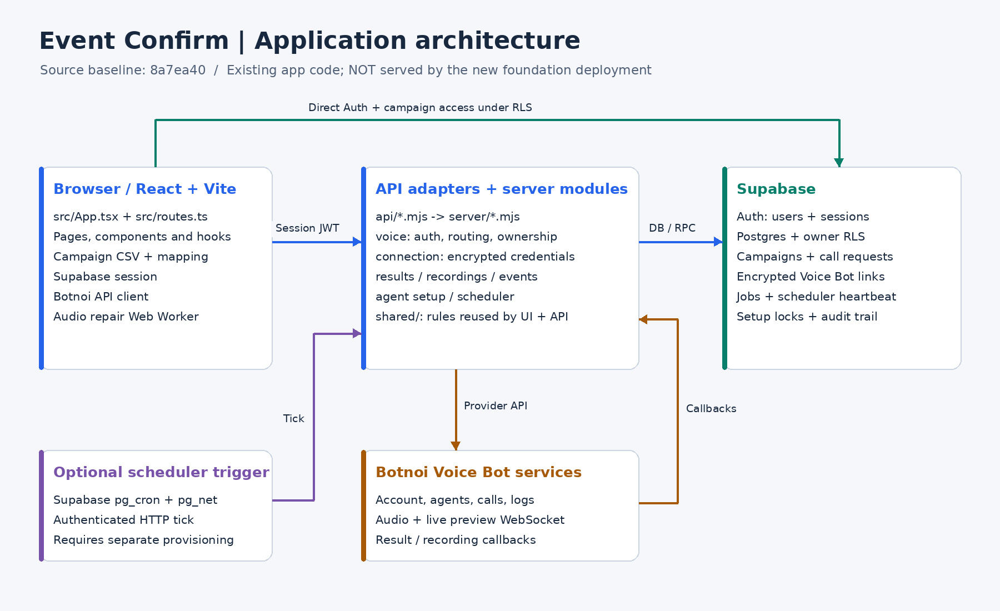
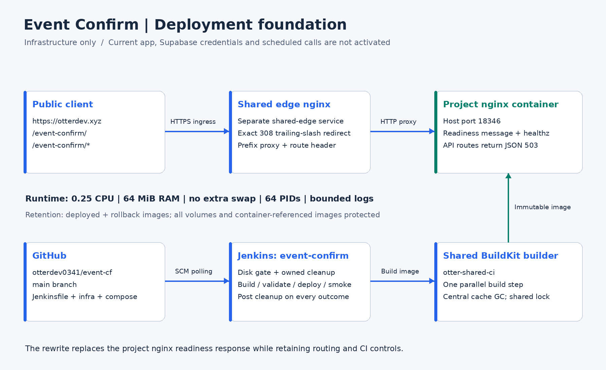

# Event Confirm: baseline ก่อน refactor

ตรวจจาก source ที่นำเข้าจาก `8a7ea40` และ foundation ที่เพิ่มใน repository นี้
เมื่อ 20 ตุลาคม 2026 เอกสารนี้อธิบายโค้ดปัจจุบัน ไม่ได้ยืนยันสถานะ Supabase,
Vercel หรือบริการ Voice Bot ภายนอก และยังไม่ได้กำหนด architecture เป้าหมายใหม่

## 1. แยก application ออกจาก deployment foundation

แอปเดิมคือ React + Vite, API adapters สำหรับ Vercel และ Supabase ภายนอก
ส่วน Jenkins ที่เพิ่มใหม่ build เฉพาะ nginx readiness service ใน `infra/`
ยังไม่ได้ build หรือให้บริการแอปเดิม ไม่มีการนำ credentials มาใช้หรือเริ่ม scheduler

## 2. โครงสร้าง source และความรับผิดชอบ

| ส่วน | ตำแหน่ง | หน้าที่ |
|---|---|---|
| Routing และ screens | `src/App.tsx`, `src/routes.ts`, `src/pages/` | เลือกหน้าจาก pathname; landing, login, campaigns, agents, inbound, analytics, settings |
| UI และ session gate | `src/components/`, `src/hooks/` | ตรวจ session, โหลด workspace, queue และ interactions |
| Campaign persistence | `src/lib/campaigns.ts` | ติดต่อ Supabase, draft/CSV/mapping, version conflicts และ import ข้อมูลเดิม |
| Browser API client | `src/services/botnoi/` | แนบ Supabase access token และส่งผ่าน `/api/voice?path=...` |
| Supabase client | `src/lib/supabase.ts` | Auth และ database access ด้วย publishable key และ user session |
| HTTP adapters | `api/*.mjs` | Vercel entrypoints บางๆ ที่เรียก server handlers |
| Application server | `server/voice.mjs` และ modules ข้างเคียง | ตรวจ auth/owner/account, dispatch operation และเรียก provider |
| Credential storage | `server/connection.mjs` | ตรวจ token ที่เชื่อมบัญชี, เข้ารหัส AES-256-GCM และอ่านผ่าน server-only store |
| Shared rules | `shared/*.mjs` และ `.d.mts` | Campaign inputs, queue identity, schedule, call results/display, audio repair |
| Database | `supabase/migrations/` | Tables, RLS, transactional RPC, rate limit, job lease และ reservation |
| Audio worker | `src/workers/recording-repair.worker.ts` | แปลงเสียงสำหรับฟังใน browser |
| Validation | `scripts/test-*.mjs` | Offline fixtures, backend behavior และ SQL/RLS tests ด้วย PGlite |

`vite.config.ts` ติดตั้ง API middleware สำหรับ development หลาย endpoint
แต่ไม่ได้ mount scheduler; `npm run preview` เป็น static preview ไม่ใช่ production API server
`vercel.json` แยก `/api/` ออกจาก SPA fallback และตั้ง function timeouts

## 3. Request และ data flow

### Login และบันทึก campaign

1. Browser login กับ Supabase Auth แล้วเก็บ session ผ่าน Supabase SDK
2. `WorkspaceGate` ตรวจ session และโหลด campaign workspace
3. Browser อ่านข้อมูลเจ้าของตนเองภายใต้ RLS และบันทึกผ่าน `save_voice_campaign`
4. RPC ตรวจ expected version เพื่อป้องกันการแก้ทับจากหลายหน้าต่าง/อุปกรณ์

### ส่งคำขอโทร

1. Browser ส่ง Supabase bearer token, request UUID และข้อมูลการโทรให้ `/api/voice`
2. `handleVoice` ตรวจ user/access mode และอ่าน connection ของ user ฝั่ง server
3. Server ถอดรหัส provider token และตรวจบัญชี, agent, campaign version และข้อมูลที่อนุญาต
4. จอง request ใน SQL ก่อนเรียก provider ผ่าน `reserve_voice_call`
   หรือ `reserve_scheduled_voice_call` สำหรับ scheduler
5. Server ส่งคำขอไป Voice Bot แล้วบันทึกสถานะ/Call ID เพื่อให้ UI อ่านต่อ
6. เมื่อผลลัพธ์คลุมเครือ เช่น timeout ระบบต้องไม่ตีความว่าโทรไม่สำเร็จแล้วส่งซ้ำทันที
   การจอง UUID ป้องกันการใช้ request เดิมซ้ำ ไม่ใช่การรับประกัน exactly-once ของ provider

### Callback, recording และ preview

| HTTP entrypoint | Handler | หน้าที่ |
|---|---|---|
| `/api/voice` | `server/voice.mjs` | Browser operations และ dispatch ไป domain modules |
| `/api/voice-result` | `server/callback.mjs` | รับผลที่ส่งกลับและผูกกับคำขอโทร |
| `/api/voice-recording` | `server/recording-callback.mjs` | รับ recording metadata |
| `/api/voice-events` | `server/general-events.mjs` | Agent HTTP Tool สำหรับ event information |
| `/api/voice-scheduler` | `server/scheduler.mjs` | Authenticated worker tick |

Callback ใช้ server-side secrets ไม่ใช่ browser session และต้องตรวจความสัมพันธ์
ของบัญชี/agent/request ก่อนเขียนข้อมูล ส่วน audio ผ่าน backend ที่ตรวจสิทธิ์ก่อน stream
live preview ขอ ephemeral token ผ่าน backend แล้ว browser ติดต่อ provider WebSocket
ด้วย token ชั่วคราวนั้น ไม่ส่ง stored provider token กลับไปให้ browser

### Optional recurring scheduler

ผู้ใช้ต้องยืนยันการตั้งเวลาเอง การสร้าง campaign ไม่เริ่มโทรโดยอัตโนมัติ
`pg_cron` + `pg_net` เป็น external trigger ที่ต้อง provision แยกจากโค้ด
worker claim job ผ่าน SQL lease ตรวจ cancellation/version/account และส่งได้สูงสุด
หนึ่งคำขอโทรใหม่ต่อ tick โดยตรวจสายเดิมก่อน ใช้ run identity สำหรับแต่ละ recurrence
และอัปเดต `voice_scheduler_health` ดูรายละเอียดใน [SCHEDULER_SETUP](../SCHEDULER_SETUP.md)
ยังไม่ได้เปิด trigger นี้ใน deployment ใหม่

## 4. Data ownership

| Entity | ความสัมพันธ์และขอบเขต |
|---|---|
| `auth.users` | ตัวตนหลักของ application user |
| `voice_campaigns` | `owner_id` อ้าง user; CSV, mapping และ campaign data อยู่ใน JSONB |
| `voice_call_requests` | คำขอโทรของ user; campaign/contact correlation อยู่ใน metadata |
| `voice_bot_connections` | หนึ่ง connection ต่อ owner; provider account และ encrypted token; browser อ่านตรงไม่ได้ |
| `voice_campaign_jobs` | อ้าง owner และ campaign ด้วย FK; มี version, lease, recurrence และ run ID |
| `voice_scheduler_health` | Heartbeat ของ worker; server-only access |
| `voice_agent_setup_locks` | Lock ตาม provider account + agent |
| `voice_agent_setup_audits` | ประวัติการตั้งค่า agent tools |

Browser ใช้ publishable key + user JWT ภายใต้ RLS ส่วน server ใช้ service-role
สำหรับงานที่จำเป็น เช่น connection/callback/scheduler จึงต้องรักษาการตรวจ ownership
ใน application code ด้วย ห้ามนำ service-role หรือ encryption key ไปไว้ใน `VITE_*`
ปัจจุบันใช้ connection ของแต่ละ user; เอกสารเก่าที่กล่าวถึง shared token ไม่ควรใช้
เป็นข้อกำหนดของ refactor โดยไม่ตรวจ source

## 5. Deployment foundation

| ส่วน | สัญญาที่ตั้งไว้ |
|---|---|
| Public prefix | `https://otterdev.xyz/event-confirm/` และทุก subpath |
| Edge owner | `shared-edge-nginx` แยกจาก otterPipeline |
| Project service | nginx, Compose project `event-confirm`, host port `18346` |
| Readiness | `/event-confirm/healthz` → 200; API prefix → JSON 503 ระหว่างรอ rewrite |
| Runtime budget | 0.25 CPU, 64 MiB, no extra swap, 64 PIDs, logs 5 MiB × 2 |
| CI | Jenkins job `event-confirm`, source `main`, shared builder `otter-shared-ci` |
| Retention | Current + rollback images; ป้องกันทุก image ที่ container อ้างถึง |
| Cleanup | Allowlist ของ generated outputs; ไม่ลบ shared caches หรือ volumes |

รายละเอียดการ deploy และ disk gates อยู่ใน [HOST_DEPLOYMENT.md](HOST_DEPLOYMENT.md)
Budget นี้สำหรับ readiness nginx เท่านั้น ต้องประเมินใหม่เมื่อเพิ่ม app/API runtime

## 6. ประเด็นที่ต้องตัดสินใจก่อน refactor

1. เลือก production HTTP server/adapter สำหรับ host นี้ โดยรักษา auth และ callback contracts
2. ทำ base path ให้รวม navigation, assets, API calls, auth redirects และ callback URLs
   ปัจจุบันมี root-absolute paths และ callback validation ที่คาด `/api/voice-result`
3. แยก routing/auth/provider transport ออกจาก `server/voice.mjs` โดยรักษา owner/account checks
4. รักษา SQL reservation, lease และ ambiguous-call handling ก่อนเปลี่ยน queue/scheduler
5. ตัดสินใจว่าจะคง browser → Supabase access หรือย้ายผ่าน backend โดยไม่สูญเสีย isolation
6. เพิ่ม app build/tests และ publish reports ก่อน cleanup ใน Jenkins; foundation smoke
   ไม่ใช่หลักฐานว่า login, โทร, callback หรือ database ทำงาน

ไฟล์ diagram เป็น JPG และมี [render.py](diagrams/render.py) สำหรับสร้างใหม่
การเปลี่ยนเอกสารรอบนี้ยังไม่เปลี่ยน application behavior หรือ migration
