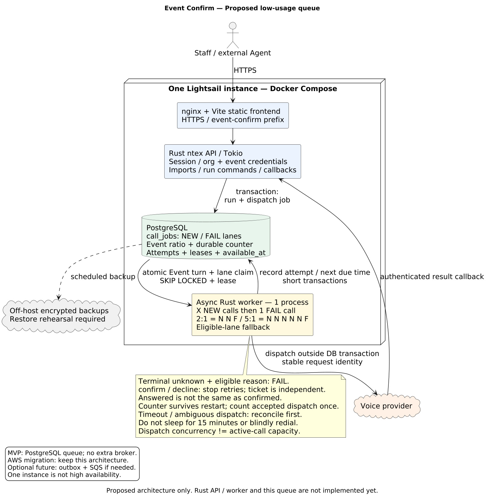

# Queue design สำหรับ usage น้อยและย้ายไป AWS Lightsail

> **อัปเดตผลการโทร:** ใช้ [CALL_OUTCOME_MODEL.md](CALL_OUTCOME_MODEL.md) เป็นข้อกำหนดล่าสุด: `confirm` / `decline` / `unknown` พร้อมเหตุผล แทน `not_confirmed` ในเอกสารนี้; confirm อาจมี ticket และ decline ไม่โทรซ้ำ

วันที่ประเมิน: 21 ตุลาคม 2026 · สถานะ: proposed design; ยังไม่ implementation/deploy
สอดคล้องกับ [แผนหลัก](REFACTOR_IMPLEMENTATION_PLAN.md) และ
[calling/retry contract](CALLING_IMPORT_CREDENTIAL_PLAN.md)

## 1. Decision

ใช้ **PostgreSQL-backed queue + Rust worker หนึ่งตัว** ใน MVP
มีสอง logical lanes คือ new จาก uploaded recipients และ fail จากโทรไม่ติด/ไม่ยืนยัน
เลือกงานแบบ X:1 เช่น 2:1 หรือ 5:1 โดยไม่เพิ่ม broker สองตัว
API และ worker ใช้ application modules และ Docker image เดียวกัน แต่แยก command/process
เช่น `event-confirm api` กับ `event-confirm worker` เพื่อ restart/limit resources แยกกันได้
ใช้ Docker Compose สำหรับ local host และ Lightsail instance

ยังไม่เพิ่ม Redis, RabbitMQ, Kafka, Kubernetes หรือ SQS ใน MVP
เหตุผลคือมี PostgreSQL อยู่แล้ว การเขียน business record กับ queue job อยู่ใน transaction
เดียวกันได้ และ retry หลายนาที/ข้ามวันเก็บด้วย timestamp โดยไม่ต้องเพิ่ม scheduler service
การย้ายไป AWS ไม่จำเป็นต้องเปลี่ยน queue เป็น AWS service

ต้นฉบับ [PlantUML](../diagrams/queue-lightsail.puml)

## 2. โครงสร้างที่เล็กที่สุด

| ส่วน | หน้าที่ |
|---|---|
| nginx/web | static Vite build, TLS/reverse proxy, `/event-confirm/` routing |
| Rust API | auth/org/event, import, call-run commands, Agent API, provider callbacks |
| Rust worker | poll due jobs, claim lease, invoke calling service, reconcile outcomes |
| PostgreSQL | business data, attempts, queue jobs และ callback dedup records |

ไม่มี database อีกชุดสำหรับ queue และไม่มี worker แยกตาม org
เริ่มหนึ่ง worker, claim batch=1, poll ทุกประมาณ 5 วินาที ปรับผ่าน config ได้
การโทรเป็น asynchronous provider API: worker ส่งคำขอแล้วปล่อย job ไม่รอสายจบค้างไว้
callback/status reconciliation เป็นผู้ปิดผล attempt และจองงานถัดไป

**Dispatch concurrency ไม่เท่ากับจำนวนสายที่กำลังคุย:** เริ่มจำกัดหนึ่ง active call ต่อ
provider connection จนทราบ provider quota; มีเพดานต่อ org/event เพิ่ม และปรับได้เมื่อทดสอบแล้ว
ตรวจ active attempts/จอง slot ภายใน transaction lock ของ provider connection ก่อน dispatch
ไม่ใช้จำนวน Tokio tasks เป็นเครื่องรับประกันจำนวนสาย active

## 3. Queue storage และขอบเขต

เพิ่มตารางเฉพาะ `call_jobs` ไม่ทำ generic workflow engine:

- `id`, `org_id`, `event_id`, `run_id`, `recipient_id`, `attempt_id`
- `kind`: `dispatch_call | reconcile_call`; dispatch jobs มี `lane`: `new | fail`
- `state`: `pending | leased | done | dead | cancelled`
- `available_at`, `lease_token`, `lease_until`, `delivery_count`, `last_error_code`
- `dedupe_key` unique ภายใน org/event, `created_at`, `updated_at`

Index สำหรับ due pending jobs บน `(org_id,event_id,lane,available_at,id)` พร้อม global due-event lookup และ expired leases บน `lease_until`
Payload เก็บ IDs ไม่ทำสำเนารายชื่อ/credential ลง queue; service โหลด snapshot และ secret
จาก store ที่ตรวจสิทธิ์; tenant FKs ป้องกัน job อ้าง run/attempt ต่าง org/event
`call_jobs(kind=dispatch_call)` เป็น durable CallDispatch ในแผนหลัก ไม่สร้าง outbox ซ้ำอีกตาราง

สถานะ business อยู่ใน CallRun/CallRecipient/CallAttempt ไม่เอา queue.state มาแสดงแทนผลการโทร
สร้าง run/recipient/attempt reservation และ enqueue initial dispatch ใน transaction เดียว
สำหรับ retryable no-connection/final not_confirmed ให้ update attempt + reserve next fail job
ใน transaction เดียวเช่นกัน; EventQueuePolicy/State เก็บ ratio/counter/pending turn แบบ durable

## 4. Claim และ execution loop

1. Worker เปิด transaction สั้น lock EventQueueState แล้วเลือก lane ตาม X:1/counter
   ใช้ `FOR UPDATE SKIP LOCKED` กับ eligible job ของ lane; fallback อีก lane เมื่อว่าง/ยังไม่ due
2. ตรวจ run/policy, credential principal ยังใช้ได้, Event/participant, cutoff และ active-call limit
3. ตั้ง pending turn + lease token/deadline และ persist dispatch reservation ก่อน commit
4. เรียก provider **นอก transaction** ด้วย stable client reference/idempotency identity
5. บันทึก provider Call ID + result และ finalize ratio counter ครั้งเดียวเมื่อ provider accepted
   โดย compare lease token/turn/version เพื่อห้าม stale worker เขียนทับ
6. Callback/final result อัปเดต attempt; retryable no-connection หรือ final not_confirmed
   enqueue fail ตาม policy; answered ที่ยังไม่มี final result ให้ awaiting_result
7. Worker อีก loop ทำ bounded reconciliation ของ submitted/unknown/stale attempts

PostgreSQL ระบุว่า `SKIP LOCKED` เหมาะกับหลาย consumer บน queue-like table
ดู [SELECT locking documentation](https://www.postgresql.org/docs/current/sql-select.html)
เริ่ม lease proposal 90 วินาที มากกว่า provider request timeout และต่อ lease หากจำเป็น
ตัวเลขจริงต้องสัมพันธ์กับ adapter timeout; ไม่จับ lock ระหว่างรอสายหรือ network response

ไม่มี loop ที่ sleep 15 นาทีเพื่อรอโทรซ้ำ: ตั้ง `available_at` แล้ว worker ไปทำงานอื่น
กรณีนอก calling window ใช้ service คำนวณเวลาที่อนุญาตถัดไปใน event timezone

## 5. แยก retry สองชนิด

| Retry | Trigger | Identity / limit |
|---|---|---|
| Technical job retry | DB/network error ที่พิสูจน์ได้ว่ายังไม่มี external dispatch | job/attempt เดิม, bounded backoff และ delivery limit |
| Business call retry | provider ยืนยัน retryable terminal no-connection หรือ final not_confirmed | attempt ใหม่, เพิ่ม attempt_no, ใช้ event max_attempts/delay |

ตัวอย่าง: สายแรก no_answer → ตั้ง `available_at = terminal_at + 15 นาที`
เมื่อถึงเวลาและยังผ่าน window/cutoff และถึง fail turn ตาม X:1 → attempt 2; proposal ไม่เกิน 3 attempts รวมสายแรก
ตัวเลขนี้ยังเป็นค่าเสนอ ไม่ถือว่าเปิดใช้งานแล้ว

Provider timeout หลังส่ง request, worker crash ช่วงส่งคำขอ หรือหมด lease **ไม่ใช่หลักฐานว่า
ยังไม่ได้โทร**: ย้ายเข้า reconciliation/unknown แทน dispatch ใหม่ ถ้าหา authoritative result
ไม่ได้ให้หยุดรอ staff review ไม่ redial ด้วยการ reset lease อย่างเดียว

`dead` หมายถึงงานเทคนิคล้มเหลวจนต้อง review ส่วน `exhausted` หมายถึงโทรครบ policy แล้ว
fail lane ของการโทรเป็นคนละอย่างกับ technical dead job
เก็บ dead jobs ในตารางเดิมและทำ admin list; ยังไม่ต้องมีบริการ DLQ แยก
กด requeue ต้องตรวจ side-effect/attempt identity ใหม่ทุกครั้ง ไม่ replay สายที่ส่งสำเร็จแล้ว
Duplicate/out-of-order callbacks ใช้ receipt dedup + monotonic state transitions
ไม่มี exactly-once guarantee ข้ามฐานข้อมูลกับ provider ถ้า provider ไม่รองรับ idempotency

## 6. Deployment บน Lightsail

เริ่มจาก Lightsail Linux instance เดียว + Compose: web, api, worker, postgres
ยอมรับได้เมื่อธุรกิจรับ downtime ระหว่าง host failure/maintenance ได้และมี tested restore
เครื่องเดียวไม่ใช่ HA แม้ใส่ restart policy ครบทุก container

Sizing hypothesis (ต้องวัด ไม่ใช่ capacity guarantee):

- 2 GB เป็นตัวเลือกทดลองเมื่อโหลดเล็กมากและ limits/pool ถูกจำกัด
- 4 GB เป็นจุดเริ่มที่มี headroom มากกว่าถ้ารวม PostgreSQL และ XLSX parsing บนเครื่องเดียว
- Build Rust/Vite บน Jenkins เดิมแล้วส่ง immutable image; ไม่ลง Jenkins หรือ compile บน Lightsail
- จำกัด import size, DB pool, password-hash concurrency, worker dispatch และ log size
- Usage เฉลี่ยต่ำยังอาจมี burst ตอนเริ่มโทร/อัปโหลด CSV ต้องทดสอบ peak batch จริง

AWS มี Lightsail plans 2/4 GB และกำหนด bundle ตาม memory/CPU/storage/network
ดู [instance bundles](https://docs.aws.amazon.com/lightsail/latest/userguide/amazon-lightsail-bundles.html)
ถ้าต้องการลดภาระดูแลฐานข้อมูล สามารถใช้ Lightsail managed PostgreSQL แยกได้ แต่มีต้นทุนเพิ่ม
และมี HA plan แยก ดู [managed database options](https://docs.aws.amazon.com/lightsail/latest/userguide/amazon-lightsail-faq-databases.html)

### สิ่งที่ต้องเปลี่ยนจาก host ปัจจุบัน

- แยก reusable base Compose กับ host overlays; current `172.17.0.1:18346` และ shared-edge
  ของ Otter host ไม่ใช่ routing contract สำหรับ Lightsail
- Lightsail มี ingress/TLS ของตัวเอง; API/DB อยู่ private Compose network ไม่เปิด DB port สู่ internet
- ตั้ง `PUBLIC_BASE_URL`, `DATABASE_URL`, callback URL, provider configuration ผ่าน environment
  พร้อม trusted proxy policy; ห้าม hardcode otterdev domain หรือ host filesystem paths
- Provision secrets บนปลายทางอย่างจำกัดสิทธิ์; ไม่ bake `.env`, org/event keys หรือ cloud keys ใน image
- Backup PostgreSQL ไป off-host storage แบบ encrypted และทดสอบ restore; machine snapshots
  เป็นอีกชั้นหนึ่ง ไม่ใช่หลักฐานว่า database restore และโทรต่อได้อย่างถูกต้อง
- ระบุ RPO/RTO กับผู้ใช้ก่อน production; daily backup อย่างเดียวอาจเสียข้อมูลระหว่างวัน
- หลัง restore เปิด `OUTBOUND_DISPATCH_ENABLED=false`, reconcile provider calls หลัง restore point
  ก่อนปล่อย queue เพื่อไม่โทรซ้ำจาก attempt records ที่ยังไม่มีใน backup
- Import staging เป็น durable storage ที่มี TTL; ย้ายไป S3 ได้ภายหลังผ่าน storage boundary
- ตรวจ SMTP/email, DNS/TLS, inbound provider callback และ outbound provider network จาก AWS จริง

## 7. ขอบเขตโค้ดเพื่อย้ายได้ง่าย

`CallingService` ดูแล eligibility/reservation/retry policy และ weighted new/fail scheduling; `ProviderAdapter` ดูแล upstream
`CallJobRepository` ดูแล enqueue/claim/complete/lease; transport ไม่เขียน business rule ซ้ำ
API กับ worker ใช้ service เดียวกัน และทุกไฟล์ไม่เกิน 300 บรรทัด

ไม่ต้องเขียน QueueProvider framework รองรับหลายระบบล่วงหน้า
เริ่ม concrete PostgreSQL repository และแยก entrypoint orchestration ให้ชัดก็พอ

Migration ที่ง่ายที่สุด: **ย้าย containers + database ไป Lightsail โดย queue design เดิม**
ถ้าภายหลังต้องขยาย worker/แยก failure domain จึงค่อยเพิ่ม SQS:

1. DB ยังเป็น source of truth ของ attempts/schedule/tenant authorization
2. เพิ่ม transactional outbox/relay ป้องกัน commit DB สำเร็จแต่ publish message หาย
3. Message มี job ID; consumer ตรวจ DB reservation/idempotency ก่อนทำงานเสมอ
4. Scheduler ยัง dispatch เฉพาะ due jobs จาก DB; ไม่เอา visibility timeout มาทำ call retry timer
5. แยก cutover consumer ไม่ให้ PostgreSQL poller กับ SQS consumer ส่ง attempt เดียวกันซ้ำ

SQS Standard ส่ง message ซ้ำได้ จึงยังต้องออกแบบ idempotency
([AWS at-least-once delivery](https://docs.aws.amazon.com/AWSSimpleQueueService/latest/SQSDeveloperGuide/standard-queues-at-least-once-delivery.html))
และ delay queue/message timer เลื่อนได้สูงสุด 15 นาที จึงไม่แทน scheduling ข้ามวันโดยตรง
([AWS delay queues](https://docs.aws.amazon.com/AWSSimpleQueueService/latest/SQSDeveloperGuide/sqs-delay-queues.html))
ไม่มีเหตุผลต้องย้าย SQS เพียงเพราะย้าย hosting ไป AWS

## 8. Readiness จาก repository ณ วันประเมิน

| ส่วน | หลักฐานปัจจุบัน | สถานะ |
|---|---|---|
| Host foundation | Compose/Dockerfile/Jenkins build nginx readiness | มี foundation; ยังไม่ใช่ business app |
| Rust/SeaORM | ยังไม่มี Cargo.toml | ยังไม่เริ่ม |
| Frontend ใหม่ | package.json ยังไม่มี Tailwind/Zustand | ยังไม่เริ่ม |
| Legacy queue | JS scheduler + Supabase job/lease SQL | มี logic อ้างอิง; ไม่ใช่ queue ใหม่ที่ยืนยันแล้ว |
| Org/event credentials + imports | อยู่ในเอกสารแผน | ยังไม่ implementation |
| Durable new/fail weighted retry | อยู่ในเอกสารแผน | ยังไม่ implementation/validation |
| AWS deployment | ยังไม่มี target Compose/provisioning/backup-restore smoke | ยังไม่พร้อม cutover |

สรุป: architecture direction เหมาะกับ Lightsail แต่ **ระบบใหม่ยังไม่ production-ready**
การคัดลอก nginx foundation ไป AWS ทำได้คนละเรื่องกับการเปิดใช้งานโทรจริง
รอบนี้ตรวจ code/config เท่านั้น ไม่ได้ทดสอบ AWS account, provision instance หรือยืนยัน live services ใหม่

## 9. Gate ก่อนเปิด production

- Rust API/worker, real PostgreSQL schema และ frontend จริงผ่าน auth/tenant contract tests
- Groovy/Spock HTTP tests ผ่าน 2:1/5:1, empty/delayed lane fallback, restart counter,
  final not_confirmed และ duplicate/late results; publish JUnit XML ก่อน cleanup
- Crash ก่อนส่ง/หลังส่ง/ก่อนบันทึกผล, duplicate callbacks และ expired lease ไม่ทำให้โทรซ้ำ
- Queue paused/cancelled/archive/revoked credentials/cutoff ถูกบังคับก่อน dispatch
- Backup restore rehearsal พร้อม outbound-disabled reconciliation และ documented RPO/RTO
- Deploy immutable version บน target, migrations under lock, previous-image rollback พร้อม
- Worker heartbeat, oldest due job age, unknown/dead jobs, disk/RAM และ failed backup มี alert
- Controlled provider test สำหรับ retryable no-connection/final not_confirmed และ weighted retry ด้วยหมายเลขทดสอบที่อนุญาต; smoke ปกติไม่โทรจริง
- ทดสอบ upload peak, active-call caps และ pool/memory limits ก่อนเลือก instance size สุดท้าย
